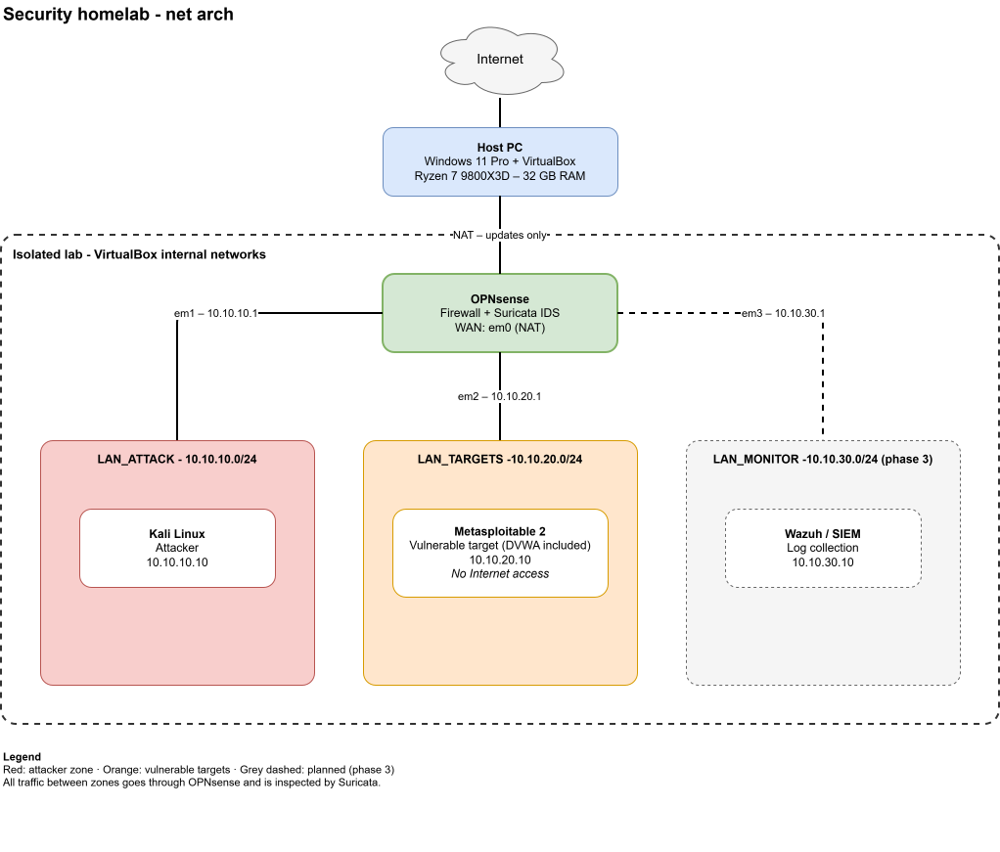

# Security homelab

This is my first hands-on cybersecurity project. I am building it to learn by
doing: each lab is set up from scratch, tested, and documented step by step,
including the mistakes and what they taught me. It builds on my background in
broadcast IP networks (multicast, SRT, network operations) and is part of my
preparation for a Master's degree in cybersecurity.

The lab is an isolated virtual network, built with VirtualBox on a single
Windows host. A firewall separates an attacker zone from a target zone, so
that every attack crosses a single point where it can be filtered, logged
and detected. The long-term goal is to study attacks against real-time media
transport (SRT, multicast) and how to detect them.

## Labs

Each lab lives in its own directory, with a short README explaining what it
does, how to build it and what I learned.

| Lab | Description | Status |
|---|---|---|
| [`lab-opnsense-firewall`](lab-opnsense-firewall/) | OPNsense firewall and router between the lab zones | Done |
| `lab-kali-attacker` | Kali Linux attacker in the attack zone | In progress |
| `lab-metasploitable-target` | Metasploitable 2 target and firewall rules | Planned |
| `lab-suricata-ids` | Suricata intrusion detection and first alerts | Planned |
| `lab-srt-multicast` | Attacks and anomaly detection on SRT and multicast streams | Planned |

The shared design (network diagram, addressing plan, firewall policy) is
described in [`common/architecture.md`](common/architecture.md).



## Requirements

- A Windows host with hardware virtualization enabled (AMD-V or VT-x) and at
  least 16 GB of RAM (32 GB recommended for all phases).
- [Oracle VirtualBox](https://www.virtualbox.org/) 7.x. `VBoxManage`, its
  command-line tool, is used by the build scripts.
- The installation images listed in each lab's README. Images are never
  stored in this repository.

## Getting started

Clone the repository, then follow the labs in order, starting with the
firewall:

```powershell
git clone https://github.com/ric-coelho-teixeira/security-homelab.git
cd security-homelab\lab-opnsense-firewall
```

Each lab's README gives the exact commands and checks.

## Repository layout

```
security-homelab/
├── common/        shared design: architecture, addressing plan, policy
├── images/        diagrams (draw.io SVG files, editable in draw.io)
├── lab-*/         one directory per lab
├── .gitignore     keeps VM images, captures and secrets out of Git
└── LICENSE
```

## Safety

All tests are performed in an isolated lab environment that I own. No
external systems are targeted. Vulnerable machines are only attached to
VirtualBox internal networks and never to a bridged or NAT adapter. No
passwords, keys or information about real networks are committed.

## License

The documentation and scripts in this repository are distributed under the
[MIT License](LICENSE).

## Other resources

- [OPNsense documentation](https://docs.opnsense.org/)
- [Kali Linux documentation](https://www.kali.org/docs/)
- [Suricata documentation](https://docs.suricata.io/)
- [MITRE ATT&CK](https://attack.mitre.org/), the knowledge base of attacker
  techniques used to describe each scenario.
- [vincentbernat/network-lab](https://github.com/vincentbernat/network-lab),
  whose layout inspired this repository.
