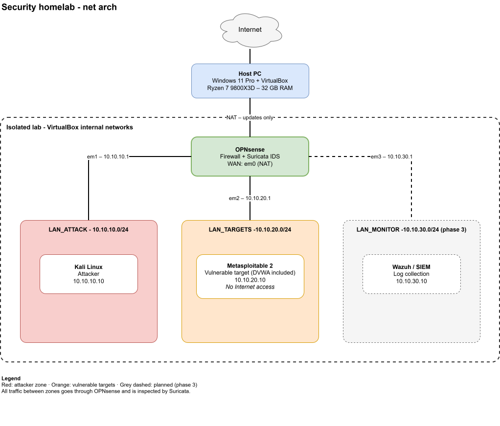

# Lab Architecture

This document describes the network design of the security homelab: a small, isolated environment used to **attack, detect and harden** network services.

## Design goals

- **Isolation:** vulnerable machines are never reachable from the home network or the Internet.
- **Segmentation:** attacker and targets live in separate subnets, and all traffic between them goes through the firewall, where it can be inspected.
- **Observability:** every attack must produce traffic that the IDS can see and log.
- **Reproducibility:** each step is documented so the lab can be rebuilt from scratch.

## Network diagram

*Editable source: open `../images/lab-network.svg` directly in [draw.io](https://app.diagrams.net).*

## Addressing plan

| Segment | VirtualBox network | Subnet | Gateway (OPNsense) | Hosts |
|---|---|---|---|---|
| WAN | NAT | DHCP from VirtualBox | — | OPNsense WAN interface |
| LAN_ATTACK | Internal network `lan_attack` | 10.10.10.0/24 | 10.10.10.1 | Kali Linux `10.10.10.10` |
| LAN_TARGETS | Internal network `lan_targets` | 10.10.20.0/24 | 10.10.20.1 | Metasploitable 2 `10.10.20.10` |
| LAN_MONITOR (phase 3) | Internal network `lan_monitor` | 10.10.30.0/24 | 10.10.30.1 | Wazuh `10.10.30.10` |

## Firewall policy (initial)

| Source | Destination | Action | Reason |
|---|---|---|---|
| LAN_ATTACK | LAN_TARGETS | Allow (logged) | Attack scenarios; traffic inspected by Suricata |
| LAN_ATTACK | Private networks (RFC 1918), including the home network | **Block** (logged) | Isolation: a compromised lab VM must never reach the home network |
| LAN_ATTACK | WAN | Allow | Kali updates and tools |
| LAN_TARGETS | WAN | **Block** | Vulnerable hosts must never reach the Internet |
| LAN_TARGETS | LAN_ATTACK | Block (except established) | Only replies to the attacker; reverse shells are logged as alerts |
| Any | OPNsense GUI | Allow from LAN_ATTACK only | Administration |

Status: the LAN_ATTACK rules are implemented and tested (November 2026), see
[`../lab-opnsense-firewall/README.md`](../lab-opnsense-firewall/README.md#6-isolate-the-attack-zone-lan-firewall-rules).
The LAN_TARGETS rules will be added with the Metasploitable 2 lab.

## Virtual machines

| VM | Role | vCPU | RAM | Disk |
|---|---|---|---|---|
| OPNsense 26.7 | Router, firewall, Suricata IDS | 2 | 2 GB | 20 GB (UFS) |
| Kali Linux | Attacker | 2 | 2-4 GB | 40 GB |
| Metasploitable 2 | Vulnerable target (DVWA included) | 1 | 512 MB | 8 GB |
| Wazuh (phase 3) | Log collection and correlation | 2 | 4 GB | 50 GB |

Phase 1 runs in about 6 GB of RAM. Phase 3 (Wazuh) needs about 10 GB.

## Host

| Component | Value |
|---|---|
| Hypervisor | Oracle VirtualBox 7.2 (type 2) on Windows 11 Pro |
| CPU | AMD Ryzen 7 9800X3D (8 cores / 16 threads, AMD-V) |
| RAM | 32 GB (about 12 GB reserved for the lab at full load) |
| Storage | 1.4 TB free; VMs stored in a dedicated folder |

A second machine (laptop, 16 GB RAM) may later become a dedicated Proxmox node (type 1 hypervisor).

## Roadmap

1. **Phase 1 - Build:** VirtualBox networks, OPNsense, Kali, Metasploitable 2; connectivity tests.
2. **Phase 2 - Attack and detect:** Nmap scans, service exploitation, DoS attempts; Suricata alerts and custom rules.
3. **Phase 3 - Centralise:** Wazuh agents and dashboards; correlation of firewall, IDS and host logs.
4. **Phase 4 - Media transport:** multicast and SRT streams (FFmpeg, srt-live-transmit) inside the lab; attack scenarios and detection of anomalies in real-time media traffic (Suricata, Zeek).
5. **Phase 5 - Harden:** apply mitigations, re-run the attacks, compare results.

## Safety rules

- Metasploitable 2 is **never** attached to a bridged adapter or NAT.
- No passwords, keys, tokens or real network information are committed to this repository.
- All attacks target machines inside this lab only.
